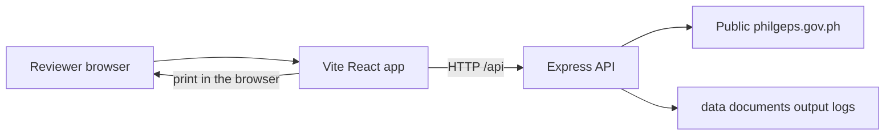
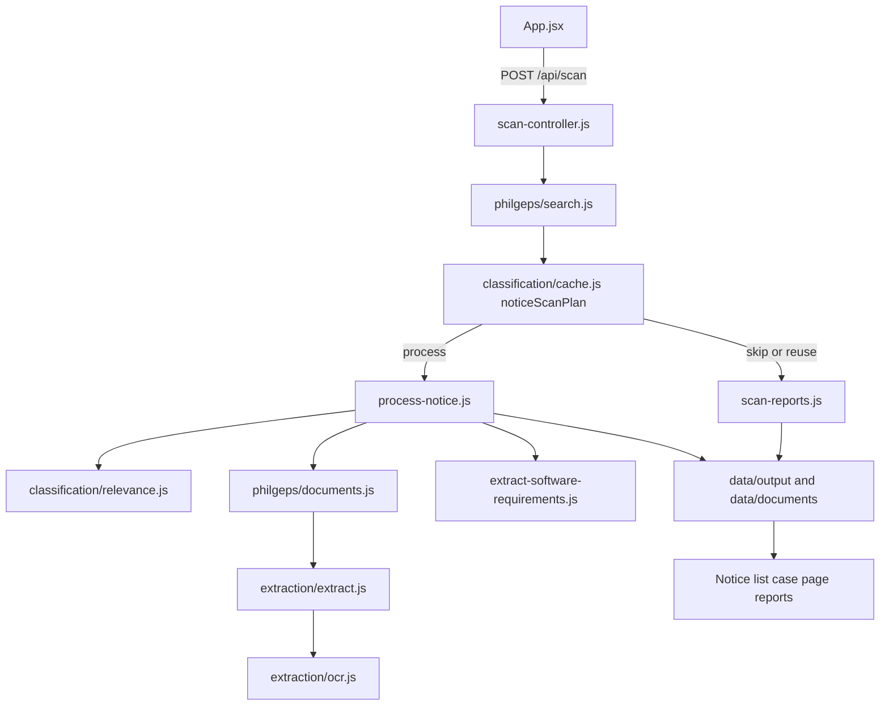

# System architecture

This document describes the system as it is implemented. Current PhilGEPS and Old PhilGEPS are both scanners. They do not share a fetch path.

## Overview

The project is a local application. A React page in the browser talks to an Express API on the same computer. The API reads public PhilGEPS HTML, saves files under `data/`, and returns JSON. Nothing in the repository deploys this app to a public host.



## Frontend

The interface lives in `frontend/`. Vite serves it in development, usually at `http://localhost:5173`. `frontend/vite.config.js` proxies every `/api` request to `http://localhost:3000`, or to `API_PROXY_TARGET` when that variable is set. Docker Compose sets it to `http://api:3000`. `docker-compose.yml` is a local run option. The app still starts with `npm run dev`.

| Area | Files | Role |
|------|--------|------|
| Homepage | `frontend/src/App.jsx`, `frontend/src/components/Hero.jsx`, `frontend/src/scan-portal.js` | Loads notices and starts a scan. Current PhilGEPS uses a publish-date range. Old PhilGEPS uses a page limit of 1 to 5. Both use the same hold-to-scan button. Scan totals stay on the report pages. |
| Counts and filters | `frontend/src/notices.js` | Counts classifications and filters the list |
| Dates | `frontend/src/format.js`, `frontend/src/scan-range.js` | Month-first display and scan-range checks before POST |
| Case page | `frontend/src/components/NoticeDetails.jsx` | One saved notice, classification, work status, print |
| Requirements | `frontend/src/components/ProcurementRequirements.jsx` | Saved requirement fields and the technical summary |
| Summary rules | `frontend/src/requirements/technical-summary.js` | Display-only grouping of already saved fields |
| Reports | `frontend/src/reports/` | Daily scan report list, one report, and the case PDF view |
| Print styles | `frontend/src/reports/print.css` | A4 portrait layout for the browser print dialog |

The case PDF and the daily scan PDF are not files generated by the server. `CaseReport.jsx` and `DailyScanReport.jsx` render HTML. The reviewer uses the browser Print dialog to save a PDF.

## Backend

`src/server/server.js` creates the Express app, listens on `process.env.PORT` or `3000`, and mounts the routes below. `src/index.js` is the command-line entry for a single notice, `--scan`, `--svp`, reclassify, and the older `review.html` page. The React app uses the Express server, not `src/index.js`.

### API routes

| Method | Path | Handler | Responsibility |
|--------|------|---------|----------------|
| GET | `/api/status` | `server.js` | Returns `{ status: "ok", name: "PhilGEPS Automation" }` |
| GET | `/api/notices` | `getNotices` | Lists saved `data/output/<digits>.json` and `data/output/legacy-<digits>.json` packets |
| GET | `/api/notices/:id` | `getNoticeById` | One packet, plus `extractedRequirements` when a requirements file exists |
| GET | `/api/notices/:id/documents` | `getNoticeDocuments` | Filenames and local open URLs |
| GET | `/api/notices/:id/documents/:filename` | `getNoticeDocument` | Sends one file, after a path check |
| PATCH | `/api/notices/:id/classification` | `updateNoticeClassification` | Manual software, review, or not relevant |
| PATCH | `/api/notices/:id/work-status` | `updateNoticeWorkStatus` | `new`, `in-progress`, or `done` |
| POST | `/api/scan` | `startScan` | Starts one Current PhilGEPS scan, HTTP 202, or 409 if a scan is already running |
| POST | `/api/scan/legacy` | `startLegacyScan` | Starts one Old PhilGEPS scan for 1 to 5 open-list pages. Same 202 and 409 behavior. The two routes share one in-process lock. |
| GET | `/api/scan/status` | `getScanStatus` | Live progress object |
| GET | `/api/scan/reports` | `getScanReports` | Index of saved daily reports |
| GET | `/api/scan/reports/:id` | `getScanReportById` | One report JSON, 404 if missing |

Unknown errors become HTTP 500 `{ error: "Internal server error" }`.

## Modules and how they connect



| Module | Directory or file | What it does |
|--------|-------------------|--------------|
| Scanner | `src/philgeps/search.js`, `src/scan.js` | Current PhilGEPS. Reads open-tender pages for a publish-date window and walks each notice |
| Old PhilGEPS reader | `src/philgeps-legacy/` | Public open-list pages and abstracts on `notices.philgeps.gov.ph`. Does not call `src/scan.js` |
| Classifier | `src/classification/relevance.js`, `config/relevance.json` | Labels text software, review, or not relevant |
| Scan plan | `src/classification/cache.js` `noticeScanPlan` | Chooses skip, reuse, or process |
| Downloader | `src/philgeps/documents.js`, `src/philgeps/client.js` | HTTP GET with timeout, delay, and one retry |
| OCR | `src/extraction/ocr.js` | Tesseract on PDF pages that have no text layer |
| Text extraction | `src/extraction/pdf.js`, `docx.js`, `xlsx.js`, `extract.js` | pdfjs, mammoth, and the xlsx package |
| Requirements | `src/extraction/software-requirements.js` | Provenance fields written to `.requirements.json` |
| Storage | `data/output`, `data/documents`, `data/logs` | JSON packets, original files, and scan logs |
| Reporting | `src/scan-reports.js` | One immutable JSON file per scan start time |
| Progress | `src/scan-progress.js` | In-memory counters for `GET /api/scan/status` |

`scan-reports.js` is on the diagram above. It writes one file under `data/output/scan-reports/` when a scan finishes. The React report pages read those files through the API. They do not create a PDF on the server.

## Why it works this way

The longer rationale is in [PROJECT_DOCUMENTATION.md](PROJECT_DOCUMENTATION.md) sections 5, 7, and 17. The implementation choices are:

| Choice | What the code does |
|--------|--------------------|
| Progressive evidence | Title first. Structured PhilGEPS fields only when the title decision is `inspect`. One temporary attachment only if it is still unclear. Full download only after software is confirmed. |
| Review | Mixed or incomplete text stays `review` so the tool neither keeps a false software case nor drops an unclear one. |
| Provenance | Saved requirement fields keep a source and a confidence. Missing values stay null. Conflicts stay visible. |
| Reuse | A manual classification, or a packet that already has `requirements` and `relevance`, is not classified or downloaded again. |
| Immutable reports | `writeScanReport` will not replace an existing `scan-reports/<startedAt>.json`. |
| No commercial action | The tool does not price, quote, match a product, or submit a bid. |

## Scan decision

`noticeScanPlan` in `src/classification/cache.js` runs before a notice is downloaded again:

1. A packet with `classificationSource === "manual"` is reused.
2. A title that `downloadDecision` marks `skip` is not saved and is counted not relevant for that scan.
3. A saved packet that already has `requirements` and `relevance` is reused.
4. Otherwise the notice is processed by `processNotice`.

Title skips from step 2 are scan rows only. They are not `data/output/<id>.json` files. `processNotice` is different: a direct call can save a not-relevant packet on a title skip, and a window-scan `process` call can still save a not-relevant or review packet after structured fields or the temporary first-file check. The two diagrams in [AUTOMATION-WORKFLOW.md](AUTOMATION-WORKFLOW.md) keep those paths apart.

## Saved files

| File | Written by | Contents |
|------|------------|----------|
| `data/output/<id>.json` | `saveResult` in `process-notice.js` | Notice fields, document list, classification, review, work status |
| `data/output/<id>.extracted.txt` | extraction | Text read from attachments |
| `data/output/<id>.requirements.json` | `extractAndSaveSoftwareRequirements` | Software requirement fields with `value`, `source`, and `confidence` |
| `data/documents/<id>/` | downloader | Original attachments and `metadata.json` |
| `data/output/scan-reports/<startedAt>.json` | `writeScanReport` | One daily scan report. Not replaced if the file already exists |
| `data/output/svp-batch.json` | `processCollectedNotices` | Rows from the latest scan or `--svp` run |
| `data/logs/` | `src/log.js` | Text log for a scan |
| `data/output/review.html` | `writeReviewList` | Older static review page used by `node src/index.js --review` |

`<id>` for a Current PhilGEPS packet is digits. An Old PhilGEPS packet is `legacy-<digits>.json`. `getNotices` lists those two filename shapes and skips other JSON, including scan reports. The same number can exist on both portals. The legacy file does not replace the numeric file.

A requirement field looks like:

```json
{
  "value": "2",
  "source": "philgeps-structured",
  "page": null,
  "confidence": "medium"
}
```

`source` is `philgeps-structured` or a downloaded filename. `page` is often null because PDF text extraction does not keep page numbers.

## Homepage statistics

`GET /api/notices` returns every saved Current PhilGEPS packet and every saved `legacy-<digits>.json` packet. It does not filter by date. A packet with no `source` field is labeled Current PhilGEPS.

`App.jsx` then calls `noticesInPublishedRange` and `countClassifications` in `frontend/src/notices.js`.

- With no published-date filter, the cards count every saved notice. The label on the page is "All saved dates".
- If the reviewer sets a published From or To date, those same cards count only saved notices in that range.
- `all` is the number of notices in that set.
- `software`, `review`, and `not relevant` count `packet.classification`. A notice is in one of those buckets, not more than one.
- Title-only skips that were never saved are not in these cards.
- Featured software cards hide notices whose work status is `done`. The statistics card still counts them as software.

## Daily scan report counts

`countScanRows` in `src/review/summary.js` counts the rows of one scan. Each reference number is counted once. The buckets do not overlap:

| Count | Meaning in that scan |
|-------|----------------------|
| `processed` | Unique reference numbers in the scan rows |
| `software` | Newly classified software. Reused packets are not in this number |
| `review` | Newly classified review |
| `notRelevant` | Title skips and newly saved not-relevant notices |
| `alreadyProcessed` | Reused saved packets, any classification |
| `errors` | A notice that threw or returned an error row |
| `documentsDownloaded` | New downloads only. Reused notices add zero |

`buildScanReport` in `src/scan-reports.js` copies those progress counts and also builds `softwareOpportunities`. That list includes a row when `isRelevant` is true and `needsReview` is not true, whether or not `alreadyProcessed` is true. Duplicates collapse with `noticeReportIdentity` (an explicit `identity`, otherwise the reference number). `counts.matchingSoftware` is the length of that list. Each opportunity has `previouslySaved: true` when the row was reused.

So a repeat scan can show `software: 0` and `matchingSoftware: 24` at the same time. The 24 were already stored and were not classified again.

## Timestamps

| Field | Where | Meaning |
|-------|--------|---------|
| `startedAt` | `resetScanProgress` sets `Date.now()` | Epoch milliseconds. This number is the report file name |
| `finishedAt` | `buildScanReport` | ISO time when the report object is built |
| `generatedAt` | `writeScanReport` only | ISO time when the file is first written. A second write does not change it |
| `from` / `to` | scan progress | Publication dates `YYYY-MM-DD`, not the clock time of the scan |
| Notice `postedDate` | PhilGEPS packet | The publish date stored on the notice |

The report UI formats scan clock times in Asia/Manila. It does not treat a notice publish date as a scan time.

## Old PhilGEPS scanner

`src/philgeps-legacy/` reads only public pages on `https://notices.philgeps.gov.ph`. The dashboard chooses Current PhilGEPS or Old PhilGEPS. Current PhilGEPS still scans a publication-date range. Old PhilGEPS scans a required page limit of 1 to 5. Each open-list page shows about 20 current open notices. The next page is an ASP.NET form post that carries the viewstate from the page just received. There is no stable page-number URL.

The reader keeps Small Value Procurement notices after reading the abstract's procurement mode. It does not use Detailed Search. Public Detailed Search has no Small Value Procurement filter and no reliable publication-date filter.

Saved notices use `legacy-<refID>.json` and `source` `{ id: "legacy", label: "Old PhilGEPS" }`. Dates from `DD/MM/YYYY` are normalized inside `src/philgeps-legacy/dates.js` before they are stored. An existing `legacy-<refID>.json` is left unchanged. Duplicate reference ids on later pages are skipped.

Classification reuses the existing title and structured-field decision. When that decision would need an attachment, the notice is saved as review. The reader does not open login-protected document pages, does not download attachments, and does not run OCR or document requirements extraction. If the abstract links to the document request list, the packet records `documentAccess: "login-required"`. The interface then shows "Documents unavailable — login required".

A finished Old PhilGEPS run writes the usual scan report plus `source` and a `legacy` block: page limit, pages visited, notices inspected, Small Value notices, software, not relevant, review, notices saved, duplicates skipped, and errors. Those figures stay on the report. They are not listed under the scan button.

The walk stops on a request failure, an expired viewstate, the site error page, or an interrupt. Files already written stay. One scan can run at a time, whether it is Current or Old PhilGEPS.

## What is not in this architecture

- No login to PhilGEPS and no bid submission.
- No database. Storage is JSON and downloaded files.
- No server-side PDF renderer. Printing uses the browser.
- No historical archive of closed Old PhilGEPS notices. The public list is open opportunities, capped at five pages.
- No Old PhilGEPS attachment download, OCR, or document-based requirement extraction.
