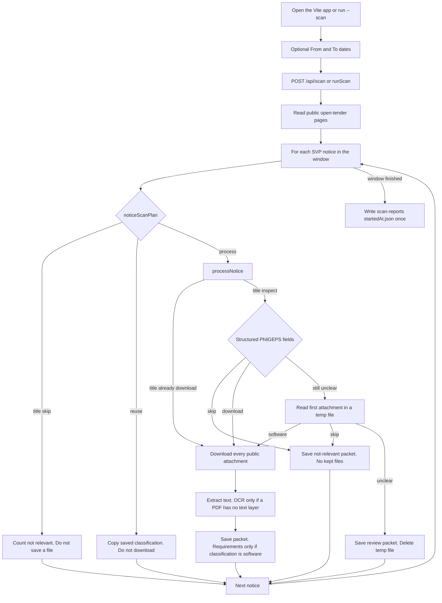
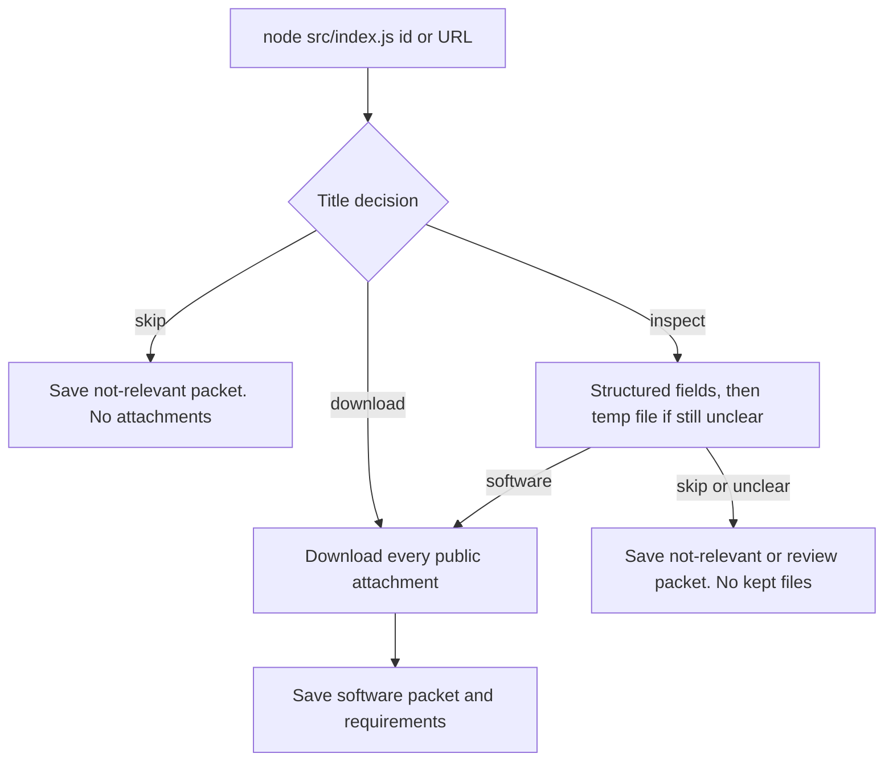

# Automation workflow

This is the path the application actually takes when a reviewer scans public PhilGEPS Small Value Procurement notices. Each step names the code that performs it.

Phase 3 is not part of this workflow.

## Window scan

`POST /api/scan` and `node src/index.js --scan` use this path. `--svp` uses the same `noticeScanPlan` loop after `fetchLatestSvp`, with a count limit. It is not the direct path in the next diagram.

The Scan PhilGEPS control starts the request only after the hold completes. Releasing early cancels it.



A title `skip` from `noticeScanPlan` never calls `processNotice`. Classification for a processed notice is chosen before the full download. `saveResult` does not classify the combined text again. That text is stored and, for software, used for requirements.

Why Review exists, and why evidence is gathered in this order, is in [PROJECT_DOCUMENTATION.md](PROJECT_DOCUMENTATION.md) section 5.

## Direct notice processing

`node src/index.js <id>` and a PhilGEPS notice URL call `processNotice` directly. There is no `noticeScanPlan`, no date window, and no scan-report file from this command.



A title `skip` here does write `data/output/<id>.json`. On a window scan that same title never reaches this function.

## 1. The reviewer opens the application

Two processes must be running: `npm run dev` in the project root (Express on port 3000) and `npm run dev` in `frontend/` (Vite). The browser loads the Vite page. `App.jsx` calls `GET /api/notices` and `GET /api/status`.

If the API is down, the page shows an error state. It does not invent notice counts.

## 2. Date range

The date controls show a month-first calendar. The values stored for the request are `YYYY-MM-DD`. `validateScanRange` in `frontend/src/scan-range.js` sends no JSON body when both fields are empty.

The server uses `resolveScanPublicationWindow` in `src/scan-range.js`. An empty request becomes today and the three previous calendar days, using the Asia/Manila calendar (`publicationWindow(manilaToday(), 3)`).

If one of From or To is missing, either value is not a real `YYYY-MM-DD` date, or From is after To, the API returns HTTP 400 and the scan does not start. `parseScanRangeBody` does not cap the number of days. A wide window can still end early because pagination stops at 200 pages.

These dates are PhilGEPS publish dates. They are not the time the scan button was pressed.

The separate published-date filter on the notice list only changes which saved records the homepage shows. It is not sent as the scan window.

## 3. Scan PhilGEPS

The button label is "Scan PhilGEPS". The reviewer presses and holds. `Hero.jsx` starts the scan only after the hold completes. Releasing early cancels it. If the page already shows a scan in progress, the hold does nothing.

## 4. The frontend sends the request

```http
POST /api/scan
Content-Type: application/json

{ "from": "2026-10-05", "to": "2026-10-08" }
```

An empty form omits the body. `startScan` in `src/server/controllers/scan-controller.js` returns:

- `202` `{ status: "started", from, to }` when a custom window was accepted. `from` and `to` are omitted for the default window.
- `409` `{ error: "A scan is already running" }` when `beginApiScan` is already in progress.
- `400` `{ error: "..." }` when the dates are invalid.

The scan continues on the server after the 202 response. The page polls `GET /api/scan/status` until `running` is false, then calls `GET /api/notices` again.

## 5. The backend searches public notices

`runScan` in `src/scan.js` calls `fetchSvpInWindow` in `src/philgeps/search.js`.

Each page is:

`{PHILGEPS_BASE_URL}/indexes/view-more-open-tenders?page={n}&direction=Tenders.id+desc`

The default base URL is `https://philgeps.gov.ph`. `src/philgeps/client.js` sends a browser-like User-Agent, waits `REQUEST_DELAY_MS` (default 1000) between pages, and retries a failed GET once.

`selectSvpInWindow` keeps a row only when the procurement mode matches `small value procurement` and the posted date falls inside the window.

## 6. Pagination and duplicates

`fetchSvpInWindow` walks pages until one of these stops it:

| Stop | `completionReason` | `complete` |
|------|--------------------|------------|
| A page is entirely older than From | `date-boundary` | true |
| A page has no rows | `empty-page` | true |
| The same notice IDs appear on two pages in a row | `repeated-page` | false |
| Page 200 is reached (`WINDOW_SAFETY_MAX_PAGES`) | `safety-limit` | false |

Within a page and across pages, a reference number already in the selected list is not added again (`pageReferenceFingerprint` detects a repeated page).

`complete: false` means the date window might be incomplete. The scan still classifies the notices it did collect, and it still writes a report.

## 7. Was this notice saved before?

For each selected notice, `processCollectedNotices` calls `savedNotice`, which reads `data/output/<referenceNumber>.json` when that file exists.

## 8. Previously saved notices are reused

`noticeScanPlan` returns `reuse` when:

- `classificationSource` is `manual`, or
- the packet already has both `requirements` and `relevance`.

Reuse copies the saved relevance and classification onto the scan row, sets `alreadyProcessed: true`, and does not call `processNotice`. It does not re-download documents and does not run the classifier again.

A reused software notice still counts as a matching software opportunity later. It does not count as new software.

## 9. New notices are classified

Notices that are not skipped and not reused go to `processNotice` in `src/process-notice.js`.

Classification uses `classifyText` and `downloadDecision` in `src/classification/relevance.js`, with terms from `config/relevance.json`. The labels the UI stores are:

| Stored `classification` | When |
|-------------------------|------|
| `software` | Relevant software purchase, `needsReview` is not set |
| `review` | Mixed or unclear text a person should read |
| `not relevant` | Clear hardware, services, connectivity, events, or similar |

On a window scan the title was already checked by `noticeScanPlan`. A title `skip` does not enter `processNotice` and does not save a file. A direct CLI call does not have that earlier check, so a title `skip` inside `processNotice` saves a not-relevant packet with no attachments.

`downloadDecision` returns `skip`, `download`, or `inspect`.

`inspect` means the title was not enough. `processNotice` then classifies PhilGEPS structured fields. A structured `skip` saves a not-relevant packet and does not keep files. A structured `download` continues to the full attachment download. If the notice is still unclear, `confirmVagueNotice` reads the first attachment into a temporary file. OCR on that file can stop early. The temporary file is always removed. Software continues to a full download. A document `skip` saves not relevant. An unclear result, including an OCR failure, saves review. Neither of those keeps the attachment.

The classification used in `saveResult` is the one chosen in the steps above. Combined document text is not classified again.

## 10. Relevant documents are downloaded

When the decision is to continue, `src/philgeps/documents.js` downloads public attachments into `data/documents/<id>/`. An existing file with the same name is not overwritten. `metadata.json` records the download list.

A failed download is recorded on the notice. The scan does not abort the whole batch for one failed file. `processCollectedNotices` sets `failed` when `processed.failedDownload` is true, and continues with the next notice.

## 11. PDF, DOCX, and XLSX, including OCR

`extractDocumentText` in `src/extraction/extract.js` chooses the reader by extension:

| Extension | Reader |
|-----------|--------|
| `.pdf` | `extractPdfText` using pdfjs-dist |
| `.docx` | mammoth |
| `.xlsx` | the `xlsx` package |

Other extensions throw `UNSUPPORTED_DOCUMENT`.

PDF text comes from pdf.js `getTextContent`. Lines are grouped by vertical position. Headings, tables, and page numbers are not preserved. That is why later requirement fields often have `page: null`.

If a PDF has no usable text layer, `src/extraction/ocr.js` renders pages with `@napi-rs/canvas` and reads them with Tesseract (`eng`).

| OCR use | Page cap |
|---------|----------|
| Classification | 6 pages (`DEFAULT_MAX_OCR_PAGES`), and it can stop early when the text is already decisive |
| Requirement extraction | 20 pages (`EXTRACTION_MAX_OCR_PAGES`) |

Near-blank pages are skipped. A page that exceeds `OCR_PAGE_TIMEOUT_MS` (default 8000) keeps the text gathered so far. The whole OCR run stops at `OCR_TIMEOUT_MS` (default 15000). The longest rendered edge is capped at 1400 pixels.

## 12. Structured procurement information

For a notice classified `software`, `extractAndSaveSoftwareRequirements` writes `data/output/<id>.requirements.json`.

Fields are taken from PhilGEPS structured values and from patterns in the extracted text. Each kept value stores a source and a confidence. Conflicting values stay visible. A value that was not found is null or an empty list. The extractor does not invent a product, a price, or a deadline.

Technical clauses are admitted by keyword, then split into sentences. A sentence split is not checked against the keyword again, so a long bidding PDF can store many clauses that are contract text rather than product specifications. The case page does not treat that list as the summary.

## 13. Saved case records

`saveResult` writes `data/output/<id>.json` with the notice, document names, relevance, classification, and work status. New software notices start as work status `new`. A later reuse does not reset `new`, `in-progress`, or `done`.

Software extraction also writes `data/output/<id>.extracted.txt` when text was read.

`processCollectedNotices` then rewrites `data/output/svp-batch.json` with the rows of this run and refreshes `data/output/review.html`.

## 14. Homepage statistics

After the scan, the page loads `GET /api/notices` again. `countClassifications` counts `classification` on the saved packets currently in the published-date filter. With no filter, that is every saved numeric JSON file. See [ARCHITECTURE.md](ARCHITECTURE.md) for the difference between these cards and a scan report.

## 15. Daily scan reports

When processing finishes, `persistFinishedScanReport` builds a report from the in-memory progress and the row list, then `writeScanReport` stores:

`data/output/scan-reports/<startedAt>.json`

`startedAt` is the epoch milliseconds from `resetScanProgress` at the beginning of the scan. `finishedAt` is the ISO time when the report object is built. `generatedAt` is set only inside `writeScanReport`.

If that filename already exists, the function returns `{ saved: false, reason: "exists" }` and leaves the file unchanged. Historical reports are not rewritten when the classifier or the UI changes.

`GET /api/scan/reports` lists those files. `GET /api/scan/reports/:id` returns one file. The React report page renders it. Print uses the browser.

If PhilGEPS search throws before any notice is processed, `runScan` marks the progress incomplete with reason `error` and still tries to save a report whose row list is empty and whose `errors` array contains the message.

If saving the report throws, the scan logs a warning and still returns. The notice files already written stay on disk.

## 16. Review, source documents, and export

The reviewer opens a notice from the list. `NoticeDetails.jsx` loads `GET /api/notices/:id`. Document links use `GET /api/notices/:id/documents` and `GET /api/notices/:id/documents/:filename`. If the file is missing, the API returns 404 and the page says the document is unavailable. It does not invent a link.

`PATCH /api/notices/:id/classification` with `{ "classification": "software" | "review" | "not relevant" }` stores a manual decision. The next scan reuses that packet and does not reclassify it.

`PATCH /api/notices/:id/work-status` stores `new`, `in-progress`, or `done` for software notices.

The individual case report (`CaseReport.jsx`) prints the same technical summary the case page shows. It prints how many extracted clauses exist. It does not print every clause body. Daily scan reports are a separate page and were not given that summary.

## Error handling and partial failures

| Failure | What the code does |
|---------|--------------------|
| Invalid scan dates | HTTP 400, no scan |
| Scan already running | HTTP 409 |
| PhilGEPS search throws | Progress `complete: false`, reason `error`, report with the message if `startedAt` exists, scan stops |
| One notice throws | That row is an error, `errorCount` increases, the loop continues |
| One attachment fails | `failedDownload` is recorded, other notices continue |
| OCR page timeout | Partial text is kept |
| Report file already exists | Existing report is kept |
| Report write fails | Warning in the log, saved notice files remain |
| Unreadable report JSON | `listScanReports` skips that file |

## Why a repeated scan reuses saved notices

Downloading and OCR are slow, and a second classification could change a decision a person already accepted. Reuse keeps the stored classification, the stored work status, and the stored files. The scan still lists the notice so the daily report can say it was seen again.

## Saved notices versus notices found in a date range

| Idea | What it counts |
|------|----------------|
| Notices found in the range | Unique Small Value Procurement rows PhilGEPS returned for the publish window, including title skips that were not saved |
| Notices processed | Same unique row count after the scan loop, subject to a `--svp` limit when that command is used |
| Saved notices on the homepage | `data/output/<digits>.json` files, optionally narrowed by the list's published-date filter |
| New software / review / not relevant | Only notices classified on this run |
| Previously saved | Every reused packet in this run, including software, review, and not relevant |
| Matching software | Software opportunities in this run, new and previously saved, after duplicate identities are removed |

The counters are separate on purpose. A repeat scan can show `software: 0` and a non-zero `matchingSoftware` at the same time, because matching software includes rows with `previouslySaved: true`. `notRelevant` plus `alreadyProcessed` accounts for the processed rows when there are no new software, review, or error rows.

## Why some technical clauses stay in a collapsed archive

`extractTechnical` can store hundreds of sentences from a bidding PDF, including payment and contract wording, because the keyword check applies to the parent block and the later sentence split does not repeat it. Those strings are kept so a reviewer can see what the extractor stored. They are not promoted into the Technical Requirements Summary.

The summary in `frontend/src/requirements/technical-summary.js` shows only extra stored fields that the item block does not already show: license type or edition, subscription duration, and deployment (`technical.cloudOrOnPremise`). Product, quantity, unit, and license count stay on the item block. If none of the extra fields exist, the page says no additional technical fields were extracted and points to the original documents.

"View All Extracted Clauses" is closed by default and shows 40 clauses per page, in the stored order, with the original wording. The label on the summary is: "Automatically extracted. Verify against source documents."

Source notes say "PhilGEPS" for `philgeps-structured`, or "Document 01" style labels for a downloaded file. The full filename stays on the document list, and as the `title` of the note.

## Current limitations

- Only the modern public site `philgeps.gov.ph`, and only Small Value Procurement rows on the open-tender list.
- Pagination can stop early on a repeated page or at 200 pages, with `complete: false`.
- Title-level hardware skips are counted in the scan report and are not saved as notice files.
- OCR is English, page-capped, and can misread words. `usedOcr` is stored when OCR ran.
- Technical clause lists are not a verified specification. Page numbers are usually missing.
- Browser print cannot remove the browser's own headers and footers. The reviewer turns those off in the print dialog. The app does not add its own page counter.
- The tool does not price, quote, or submit a bid.
- Legacy PhilGEPS is not implemented.
